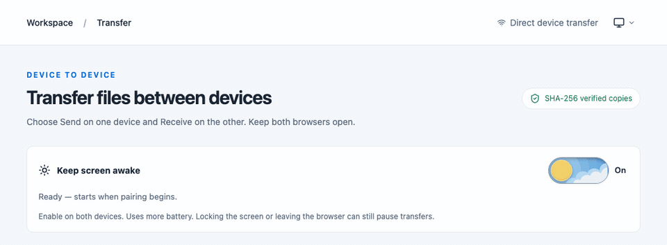
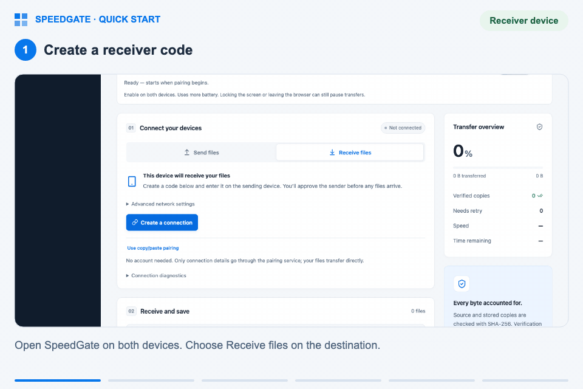
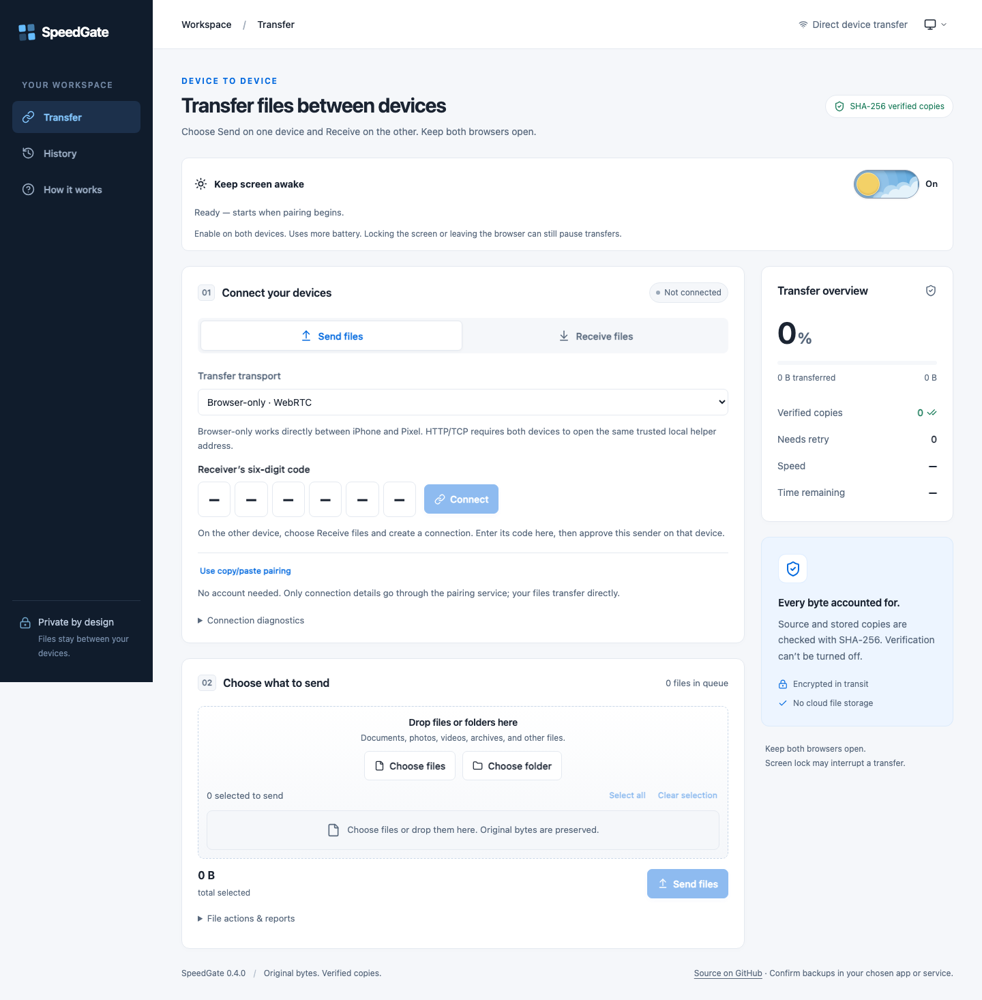
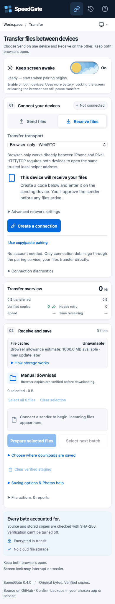
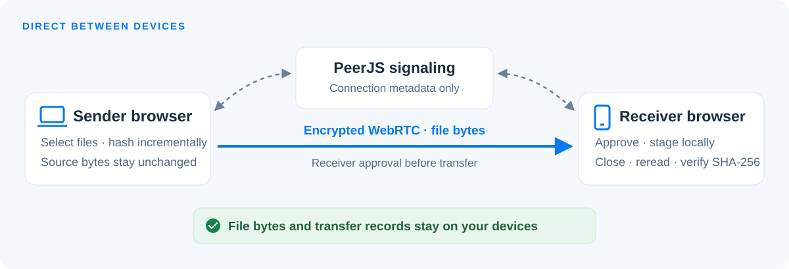
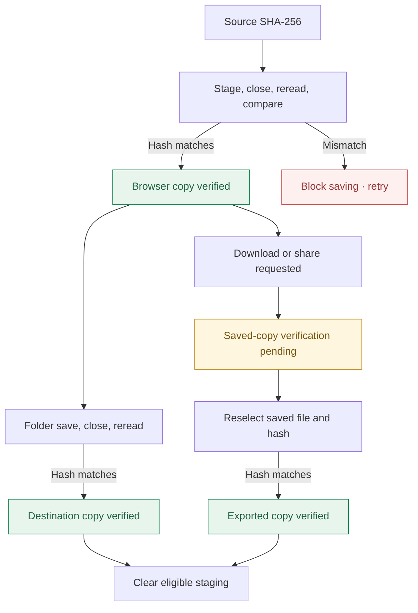

<div align="center">
  
  <h1>SpeedGate</h1>
  <p><strong>Move files. Keep every byte.</strong></p>
  <p>Direct browser-to-browser transfers with resumable checkpoints and independent SHA-256 verification.</p>
  <p>
    <a href="https://s4lmon778.github.io/PixelGate/">Live app</a> ·
    <a href="https://s4lmon778.github.io/PixelGate/releases/0.3.35/">Previous version (0.3.35)</a> ·
    <a href="#quick-start">Quick start</a> ·
    <a href="#engineering-decisions">Engineering decisions</a> ·
    <a href="docs/README.md">Documentation</a> ·
    <a href="https://github.com/s4lmon778/PixelGate/issues">Report an issue</a>
  </p>
  <p>
    <a href="LICENSE"></a>
    
    
    
    
  </p>
</div>

SpeedGate moves files between computers, phones, and tablets using their browsers. Browser-only mode sends file bytes over a direct encrypted WebRTC data channel; optional local-helper mode streams them through trusted HTTPS/TCP. The receiver closes and rereads each stored file before comparing its SHA-256 with the source. File history and receiving storage stay on the devices. In local-helper mode, the helper also sees bytes and metadata while forwarding them.

The browser-only app is a static **TypeScript / React / Vite** build hosted on GitHub Pages. **PeerJS** exchanges connection metadata for six-digit pairing; it carries no file payloads. Browser-only mode needs no native app, account, cloud media storage, or TURN relay.

> **Status:** experimental. The working version is **0.4.0**. Automated checks exercise integrity and recovery; browser capabilities, available storage, and network policies still determine usability. Large-file and physical-device boundaries are documented below.

Android senders have **Choose photos & videos** for the media library and **Choose files** for documents. Direct **Save to Photos folder** appears only when the browser supports choosing a local folder; older Chrome uses verified downloads with Photos device-folder backup. Updating the browser can enable the folder option without changing the Android system.

<div align="center">
  
  <p><sub>Recorded from the app: the screen-awake preference and appearance controls.</sub></p>
</div>

## SpeedGate 0.4.0: browser-only and optional HTTP/TCP

**The no-install iPhone → Pixel browser flow remains the default on static hosting.** SpeedGate also supports a LocalSend-inspired binary HTTP/TCP transport when both browsers open a temporary trusted LAN helper. A browser cannot host a TCP listener itself; the helper must run as a Node process on a PC/Mac or a provisioned Android environment. This is an additional mode, with a different trust boundary: the helper forwards and can see the bytes.

```sh
npm run build
SPEEDGATE_TLS_KEY=/path/key.pem SPEEDGATE_TLS_CERT=/path/chain.pem npm run serve:lan
```

For a temporary distributable ZIP, run `npm run package:helper`; the extracted helper needs an existing Node runtime but no npm install. Both devices need to trust the certificate and open the same helper address. Start with two concurrent uploads; 1–4 are configurable. The existing original-byte handling, manifests, worker hashing, readback, duplicates, progress, saving, pause/cancel and receiver-owned resume checkpoints are shared between modes. No new dependency was added.

[Setup, browser restrictions and data compatibility](docs/HTTP-TRANSPORT.md) · [REA and LocalSend research](docs/LOCALSEND-RESEARCH.md) · [Measured comparison and limits](docs/HTTP-BENCHMARKS.md)

The remaining WebRTC deployment and pairing descriptions below describe **browser-only mode**. Existing GitHub/Pages URLs remain valid under their actual repository name. Existing storage/preference/wire identifiers are intentionally retained for compatibility. Historical measurement JSON retains its original provenance; current interface recordings and screenshots were refreshed for SpeedGate 0.4.0. GitHub Pages serves browser-only mode; HTTP/TCP requires the separate temporary LAN helper.

## Contents

- [Quick start](#quick-start)
- [Features](#features)
- [Architecture](#architecture)
- [Engineering decisions](#engineering-decisions)
- [Validation and boundaries](#validation-and-boundaries)
- [Development](#development)
- [Deployment](#deployment)
- [Documentation and contributing](#documentation-and-contributing)

## Quick start

<div align="center">
  
  <p><sub>A real synthetic-file transfer, with step captions and click highlights. Playback is edited for instruction.</sub></p>
</div>

[Watch or download the 29-second video](docs/assets/quick-start.mp4) · [Recording details](docs/assets/README.md#quick-start-walkthrough)

1. Open **[SpeedGate](https://s4lmon778.github.io/PixelGate/)** on both devices, using a trusted network that permits connections between them.
2. On the destination device, choose **Receive files**, optionally choose a destination folder, and click **Create a connection**.
3. On the sender, enter the receiver's **six-digit code** or scan its QR code, then click **Connect**.
4. On the receiver, **Approve sender** for your intended device.
5. Select files or folders on the sender and click **Send files**. Keep both browsers open and foregrounded; enable **Keep screen awake** where supported.
6. Select received files directly in the scrolling list, then **Prepare selected files** and choose an app or download. A selected destination folder saves and verifies files automatically. Optional final-byte checks remain under **History → Saved-copy tools → Verify exported files**.

Codes expire after ten minutes and accept one sender. A code is a temporary lookup, not identity authentication. Same-network-name Wi-Fi can still block local connections; use a permitted network or hotspot if necessary.

For large collections, receive a batch, save it, and choose **Clear verified staging** before the next batch. It deletes SpeedGate’s cached file bytes from both storage backends, removes cleared files from the receiving list, and releases prepared download references in open tabs. Receipts remain available only in History. For downloads or app saves, confirm the save finished and the files open before clearing; optional independent saved-copy checks remain in History. Saved originals, unfinished transfers, and reports are kept. **Clear history** is a separate action that preserves staging and resume data.

On browsers without writable-folder access, **Choose where downloads are saved** is a text disclosure beneath the saving buttons. Mac Safari uses its native download flow; enable **Safari → Settings → General → File download location → Ask for each download** to choose a destination for downloads. SpeedGate cannot enable that browser setting for you.

See the [usage guide](docs/USAGE.md) for saving modes and storage behavior, or [troubleshooting](docs/TROUBLESHOOTING.md) for network and browser issues.

<details>
<summary><strong>Interface previews — desktop and mobile</strong></summary>

Screenshots show the 0.4.0 interface with empty queues, including paired saving controls and expandable help.





</details>

## Features

- **Pairing and approval:** six-digit entry, QR links, receiver consent, expiry, and revocation. Copy/paste pairing is available when signaling is unavailable.
- **Files and folders:** multiple selection, recursive drops where supported, Unicode filenames, preserved relative paths, and destination-path validation.
- **Integrity and recovery:** incremental worker hashing, independent stored-file readback, durable checkpoints, and resume after source reselection and rehashing.
- **Parallel transfers:** learn path delivery rates and sequence chunks across up to fourteen independent peer connections, recover gaps on another lane, restore order, and overlap up to eight checkpoints between capable peers, with legacy fallback.
- **Saving:** Android Chrome 132+ Photos device-folder saving for the whole collection, direct folder writes with destination readback, native save/share where supported, whole-collection verified downloads, Google Photos device-folder guidance, duplicate checks, and numbered conflicting filenames.
- **Batch controls:** inline file selection/saving, pause/resume/cancel, pinned mobile progress, optional final-byte verification in History, direct file-cache cleanup, and JSON/CSV/text reports.
- **Speed checks:** explicit peer-link measurements without storage, separate bounded internet dummy downloads, browser network estimates where available, sender stage durations, and optional 5/7-path limits for same-version comparisons. Tests run only while idle and do not upload originals or reports.
- **Accessible interface:** contained scrolling file lists, compact mobile action rows, keyboard controls, Light / Dark / System appearance, reduced-motion support, expandable help, and an optional screen-awake switch.

## Architecture

React coordinates user actions; the transfer engine owns protocol state; workers handle hashing and staging. GitHub Pages serves static assets, while PeerJS handles temporary signaling.



| Layer       | Implementation                             | Responsibility                                                       |
| ----------- | ------------------------------------------ | -------------------------------------------------------------------- |
| Interface   | React, strict TypeScript, CSS              | Pairing, approval, queues, progress, saving, appearance, and reports |
| Connection  | WebRTC, bundled PeerJS                     | SDP/ICE exchange, reliable ordered data channels, and lifecycle      |
| Integrity   | Web Workers, `hash-wasm`                   | Incremental source hashing and independent copy readback             |
| Persistence | OPFS, IndexedDB                            | Staged bytes, checkpoint metadata, local manifests, and history      |
| Tooling     | Vite, ESLint, Prettier, Vitest, Playwright | Static builds, checks, and failure-injection fixtures                |

<details>
<summary><strong>Protocol exchange and checkpoint ordering</strong></summary>

```mermaid
sequenceDiagram
    participant S as Sender
    participant P as PeerJS signaling
    participant R as Receiver
    participant W as Local staging worker
    S->>P: Connect using receiver code
    P-->>R: Connection request and SDP/ICE
    Note over S,R: Receiver approval and open channel required
    S->>R: Manifest and source SHA-256
    R-->>S: Receiver-owned resume offset
    Note over S,R: Optional parallel connections; up to eight checkpoints in flight between capable peers
    loop Each checkpoint, up to 1 MiB
        S->>R: Binary frames, 16 KiB or negotiated 64 KiB messages
        R->>W: Persist bytes
        W-->>R: Write/flush or chunk transaction complete
        R->>R: Commit manifest checkpoint
        R-->>S: Acknowledge durable offset
    end
    R->>R: Close staging, reread, and compare SHA-256
    opt Direct folder selected
        R->>R: Copy, close, and hash saved destination
    end
    R-->>S: Verification result with explicit scope
```

</details>

Signaling disconnects after activation; file transfer continues over the direct channel. STUN discovers potential routes. No TURN fallback is configured. See [Architecture](docs/ARCHITECTURE.md) for protocol controls, lifecycle limits, and compatibility storage.

## Engineering decisions

The design treats persisted progress, completed transfer, and verified saved bytes as separate states.



| Decision                    | Implementation and reason                                                                                                                                                                                                                                                                         | Evidence                                                                                                                              |
| --------------------------- | ------------------------------------------------------------------------------------------------------------------------------------------------------------------------------------------------------------------------------------------------------------------------------------------------- | ------------------------------------------------------------------------------------------------------------------------------------- |
| Bounded pipeline            | One active file, one hash ahead, one checkpoint read ahead, 16 KiB frames or negotiated 64 KiB messages on nearby healthy paths, 1 MiB durable checkpoints, up to eight checkpoints in flight between capable peers, and bounded sender backpressure with adaptive pacing constrain payload work. | [Transfer engine](lib/bridge/transfer.ts), [parallel transport](lib/bridge/striped-channel.ts), [protocol types](lib/bridge/model.ts) |
| Acknowledge persisted bytes | Worker write/flush or chunk transaction completes before manifest commit and ACK. Resume truncates uncommitted tails rather than trusting a progress counter.                                                                                                                                     | [Recovery fixtures](tests/transfer.test.ts), [real chunk-store tests](tests/browser/indexed-staging.spec.ts)                          |
| Capability-tested storage   | A full 1 MiB write/read probe selects usable OPFS or IndexedDB. Blob-cloning restrictions permit a bounded buffer retry after transaction abort; quota and integrity failures do not trigger that retry.                                                                                          | [Preflight tests](tests/staging-preflight.test.ts), [checkpoint store](lib/bridge/indexed-staging.ts)                                 |
| Copy-specific verification  | Transfer `phase` is distinct from `scope`: `none`, `browser`, `destination`, or `exported`. Download/share initiation leaves final-copy verification pending.                                                                                                                                     | [Record model](lib/bridge/model.ts), [saved-copy tests](tests/storage.test.ts)                                                        |
| Serialized ICE delivery     | A bounded candidate inbox waits for remote SDP, deduplicates candidates, and serializes additions, preventing an answer/candidate race.                                                                                                                                                           | [Candidate inbox](lib/bridge/candidate-inbox.ts), [browser fault injection](tests/browser/bridge.spec.ts)                             |
| Explicit trust boundaries   | Approval gates the transfer engine; pairing inputs and queues are bounded; path validation rejects unsafe destinations; diagnostics omit raw addresses and file information.                                                                                                                      | [Connection lifecycle](lib/bridge/code-connection.ts), [Security](SECURITY.md)                                                        |

OPFS and manifest metadata are separate persistence systems. Their ordering supports refresh/reconnect recovery; it does not establish OS power-loss durability. File identity includes both content hash and relative path, and retained verified copies must pass readback before they can be skipped.

For the original Pixel / Pixel XL, keep originals local and let Google Photos on that phone back up the device folder in Original quality. [Google documents the model-specific storage benefit](https://support.google.com/pixelphone/answer/6220791?co=GENIE.Platform%3DAndroid&hl=en). Album organization and Free up space happen in Photos; SpeedGate does not replace that device backup with a cloud API upload.

Native sharing uses a fresh user tap after file preparation so hashing does not consume transient activation. History clearing affects only the presentation log, preserving recovery records and staged bytes.

The [engineering guide](docs/ENGINEERING.md) explains these tradeoffs with source entry points and regression evidence. The [architecture reference](docs/ARCHITECTURE.md) describes the runtime model.

## Validation and boundaries

Recorded through **0.3.21 on October 10, 2026** across full and targeted runs. These are executed checks, not a continuously updated CI badge.

| Evidence                        | What was checked                                                                                                                                                                           |
| ------------------------------- | ------------------------------------------------------------------------------------------------------------------------------------------------------------------------------------------ |
| **259 unit/integration tests**  | Independent hashes, recovery, latency-relative bounded transfer windows, retained reports, ordered parallel transport, lane failure fallback, pairing lifecycle, and deployment provenance |
| Browser integration             | Real WebRTC transfers, approval, QR decoding, independent stored/exported hashes, interruption and refresh recovery, and corruption rejection                                              |
| Interface and capability checks | Mobile/desktop layouts, enlarged text, appearance, native-share fixtures, download bytes, wake-lock lifecycle, and history preservation                                                    |
| Legacy engine                   | Actual Chromium 101 compatibility storage, public signaling, downloads, checkpoint recovery, and current layout controls                                                                   |
| Physical-device reports         | Completed iPhone-to-Mac hotspot transfer; receiving, downloading, and opening files on older Pixel/iOS devices                                                                             |

Browser tests include byte-exact large transfers/downloads through OPFS and compatibility storage, including a 5 GiB + 23-byte WebKit sender fixture, plus a 125-file selection through native handoffs, automatically continued downloads, and one-action Photos device-folder saving. They use synthetic files and independent Node/Web Crypto hashes. Hardware reports lack complete device/version/capacity measurements and are recorded separately from automated engine evidence in [the validation record](docs/VALIDATION.md).

- Receiving must pass a local write/read preflight. Folder access and native share targets depend on the browser and device; downloads remain the fallback.
- Browsers must stay open. Wake lock can prevent automatic screen sleep where supported, but cannot guarantee background execution or survive manual locking and OS suspension.
- Guest, campus, hotel, or workplace networks may block direct connections even when both devices use the same Wi-Fi name. No relay is available to bypass that restriction.
- Browser quotas are estimates, and temporary sessions can discard local data. Mac HTTP transfer/download byte comparison passed at 5 GiB + 23 bytes. Physical-device transfers over 4 GB, 10,000-file sessions, and 100 GB reliability still require hardware validation.
- Picker-supplied bytes are the source of truth. Original Photos resources, complete Live Photo pairing, iCloud-original retrieval, native media scanning, and filesystem timestamp restoration are outside this version.
- SpeedGate cannot select an arbitrary photo album or verify external backup. It never reports Google Photos backup success or deletes source media.

## Development

Requires **Node.js 22.13+** and npm.

```sh
git clone https://github.com/s4lmon778/PixelGate.git SpeedGate
cd SpeedGate
npm ci
npm run dev
```

Open `http://127.0.0.1:8787`. Use separate browser profiles for local sender/receiver checks.

```sh
npm run check                  # TypeScript, ESLint, unit/integration tests
npm run build                  # Production assets in dist/
npx playwright install chromium firefox webkit
npm run test:browser           # Real peer and browser fixtures
npm run format:check           # Formatting
```

Playwright starts a production preview when needed; build first. See [Development and testing](docs/DEVELOPMENT.md) for fixture assumptions, targeted runs, and selecting an older Chromium executable.

```text
src/                 React components, appearance, responsive styles
lib/bridge/          Pairing, protocol, hashing workers, storage, and reports
lib/                 Shared pairing validation and worker declarations
tests/               Unit/integration fixtures and tests/browser/ scenarios
scripts/             Static publishing and source provenance
docs/                Usage, design, development, deployment, and validation
docs/assets/         Current interface screenshots and project artwork
.github/             Issue forms and pull request template
```

Build output, dependencies, browser reports, and environment files are ignored. Legacy internal `pixelbridge` and `pixelgate` storage, preference and WebRTC identifiers remain unchanged to preserve user data and peer compatibility; the public app is SpeedGate.

## Deployment

The app can run on any HTTPS static host. For GitHub Pages:

1. Fork or clone the repository and configure your Git `origin`.
2. Install dependencies, run checks, and commit the source.
3. Run `npm run deploy:pages`.
4. Select **Settings → Pages → Deploy from a branch → gh-pages → /(root)**.

The publisher preserves deployment history and writes the app version/source commit to `build.json`. Pushing `main` alone does not publish the site. Relative asset paths support project subpaths such as `/SpeedGate/`.

Default pairing uses PeerJS's public signaling service without an API key; shared-service availability and limits remain external dependencies. A TLS-enabled PeerServer can be selected with `VITE_SPEEDGATE_SIGNAL_URL`. No application database, media backend, analytics, or TURN service is deployed.

Moving to another origin does not migrate browser files, history, or permissions. See [Deployment](docs/DEPLOYMENT.md) for custom signaling, hosting constraints, and verification steps, and [Security](SECURITY.md) for the trust model.

## Documentation and contributing

The [documentation index](docs/README.md) links the full usage, troubleshooting, architecture, engineering, development, deployment, and validation guides.

Issues and focused pull requests are welcome. Include device/browser versions, synthetic reproduction steps, the failing stage, and relevant validation. Keep private files, pairing secrets, and network addresses out of public reports.

- [Contributing guide](CONTRIBUTING.md)
- [Security assumptions and vulnerability reporting](SECURITY.md)
- [Report a bug](https://github.com/s4lmon778/PixelGate/issues/new?template=bug_report.yml)

## License

[MIT](LICENSE) © 2026 s4lmon778. Bundled dependencies retain their respective licenses.
